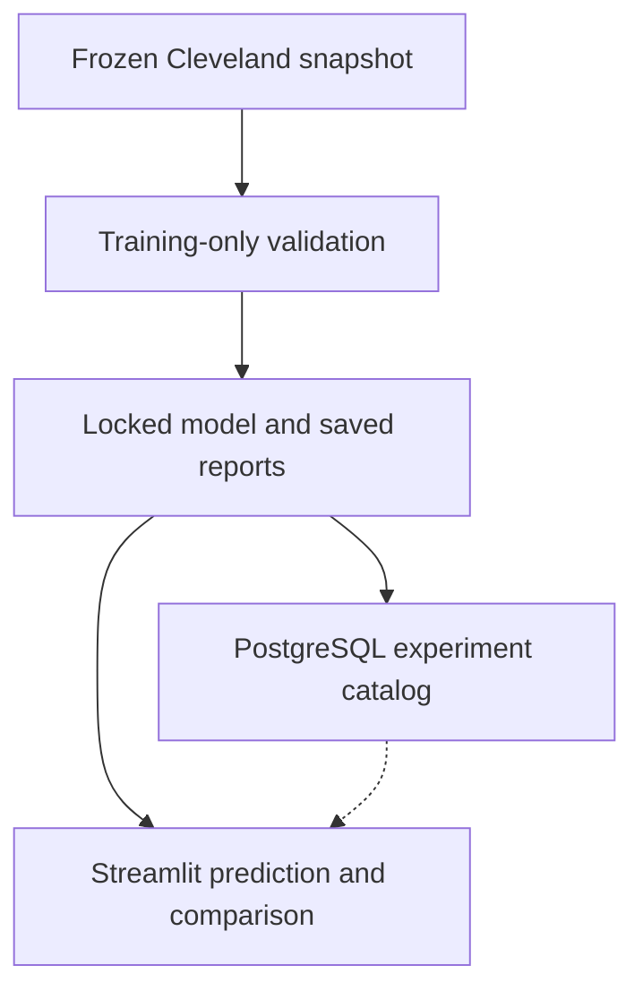

# Heart Disease Prediction System

A portfolio project connecting a frozen UCI Cleveland dataset, recall-sensitive model
selection, a Streamlit demonstration, and optional PostgreSQL experiment tracking.
It was built to show how a trained model can be evaluated, packaged for inference,
and traced back to its dataset and experiment. The stack includes Python, pandas,
NumPy, scikit-learn, XGBoost, Streamlit, Matplotlib, joblib, SQLAlchemy, Alembic, and
PostgreSQL. This is an educational demonstration using historical data. Clinical
diagnosis and future risk prediction are outside its scope.

The selected Logistic Regression pipeline uses balanced class weights, C=0.1, and
threshold 0.30. The recorded 61-row holdout produced accuracy 85.25%, recall 96.43%,
precision 77.14%, specificity 75.76%, and F2 0.9184. Its confusion matrix was
[[25, 8], [1, 27]] in TN/FP and FN/TP order. Mean outer F2 scores were 0.860
(Logistic Regression), 0.855 (Random Forest), 0.842 (XGBoost), and 0.809 (dummy).
These estimates describe a small historical dataset.



## Recruiter demo

Download the source ZIP, model, and checksum from [v0.1.0](https://github.com/azim-haffar/heart-disease-prediction-system/releases/tag/v0.1.0).
Use Windows Python 3.14.8 and follow [Demo distribution](DEMO.md) to verify
the SHA-256, place the model in `artifacts/milestone-2/`, and start Streamlit.
Only load joblib artifacts from a trusted publisher. A checksum verifies the
file's identity. It does not establish trust in the publisher.

Prediction Demo and Dataset and Methodology work without PostgreSQL. The
minimal package does not contain the private reports needed by the interactive
Model Comparison page. See [recorded results](RELEASE.md#saved-evaluation)
for the aggregate evaluation.

## Launch locally

Use Python 3.14.8 to match the saved model environment. From the project directory:

```powershell
python -m venv .venv
$python = '.\.venv\Scripts\python.exe'
& $python -m pip install -e '.[test,modeling,app,tracking]'
& $python -m pip check
& $python -m pytest -q -rs
& $python -m streamlit run app.py
```

The app has Prediction Demo, Model Comparison, and Dataset and Methodology sections.
It uses the original trusted local run at artifacts/milestone-2. A fresh checkout needs
that directory restored from the original workspace. Set HEART_RUN_DIR to use a
different trusted directory. The Release model is sufficient for Prediction Demo.
Keep model binaries and generated reports outside Git.
Joblib loading can execute code, so use only the verified artifact you control.
Application startup uses saved results. It performs no training or holdout scoring.
See [release notes](RELEASE.md) for the run bundle layout, model checksum, verified
versions, and publication status.

### Prevention Visit print walkthrough

Open **Prevention Visit** in Streamlit. The summary can be generated without the
model or PostgreSQL. Use fictional entries for the walkthrough.

1. Choose **Fictional example**, then **Europe** and **mmol/L**. Use the filled
   measurements of 132/82 mm Hg, 5.12 mmol/L total cholesterol, and 1.45 mmol/L
   HDL. Set the blood pressure and cholesterol dates to 2026-11-20 and
   2026-11-21, and set current smoking to **No**.
2. Enter only **4.2%** in Clinician assessment and submit. Check that the app
   flags the incomplete assessment and offers no download. Complete it with
   **Fictional risk tool**, **Fictional calibration cohort**, **10 years**,
   **Fictional cardiovascular outcome**, and **2026-11-22**.
3. For a wrapping check, paste 12 repetitions of
   `Please discuss our fictional prevention plan. ` and append
   `SyntheticReference` followed by 130 X characters. Generate and download
   the HTML, open it in Edge, and choose **Print → Save as PDF**, Letter,
   normal scale. Turn off **Headers and footers** to omit the local file path.
4. Repeat with **Blank summary** and **mg/dL**. Enter age 54 and total
   cholesterol 198 mg/dL and use the same wrapping note. Leave the other
   measurements and external assessment blank. Check for **Not recorded**.

**Verified:** Streamlit AppTest generated both download payloads and confirmed
the partial-entry error. Microsoft Edge headless print-to-PDF on Letter
produced one page per case after the print styles were tightened. The rendered
pages were reviewed for units, ISO dates, long-word wrapping, section breaks,
missing values, and the external estimate and its provenance. Browser headers
and footers were disabled for the final PDFs. Other browsers, physical
printers, and non-default paper sizes were outside this check.

### Optional PostgreSQL

Start Docker Desktop. Run these commands in PowerShell from the project directory.
Set a new password once for a new volume. Reuse the original password for an existing
volume. The example URL assumes a URL-safe password. Percent-encode other passwords
in the URL while passing the original value to Compose.

```powershell
$python = '.\.venv\Scripts\python.exe'
if (-not $env:POSTGRES_PASSWORD) {
    throw 'Set POSTGRES_PASSWORD before starting Compose. Reuse the original password for an existing volume.'
}
$env:DATABASE_URL = "postgresql+psycopg://heart_app:${env:POSTGRES_PASSWORD}@127.0.0.1:5432/heart_experiments"
docker compose up -d --wait postgres
& $python -m alembic upgrade head
& $python -m heart_disease.tracking
```

Registration checks the saved reports and model metadata, and uses a content fingerprint
to prevent duplicate imports. The comparison page reads matching registered metrics
when the catalog is available. The local reports and prediction form work independently
of PostgreSQL. The catalog stores experiment data and artifact references. Prediction
form values are processed in memory and are excluded from the catalog and application logs.
The saved-model and report checks passed in the project environment. Streamlit and live
PostgreSQL verification require the optional dependencies and a running Docker engine.
Set TEST_DATABASE_URL to a dedicated disposable PostgreSQL database before running
pytest to exercise migrations, idempotency, retrieval, and transaction rollback.

For offline installation, use the wheelhouse instructions below and include
streamlit, SQLAlchemy, alembic, and psycopg[binary] in the download command.
Install with the same extras as above and add --no-index --find-links C:\wheelhouse.

## Reproduce

From the project root in PowerShell with Python 3.11 or later:

```powershell
python -m venv .venv
.\.venv\Scripts\python.exe -m pip install -e ".[test]"
.\.venv\Scripts\python.exe -m heart_disease audit --output artifacts/audit.json
.\.venv\Scripts\python.exe -m heart_disease split --output artifacts/split.json
.\.venv\Scripts\python.exe -m heart_disease prepare --output artifacts/preparation.json
.\.venv\Scripts\python.exe -m pytest -q
```

The audit and split can also run with only the Python standard library:

```powershell
$env:PYTHONPATH = "src"
python -m heart_disease audit
python -m heart_disease split --output artifacts/split.json
python -m unittest discover -s tests -p test_dataset.py -v
Remove-Item Env:PYTHONPATH
```

Commands use the bundled snapshot and verify its SHA-256 before parsing. `--data` can point to another copy of those bytes. The CLI prints JSON when no output path is given. The checked-in [split manifest](data/split.json) uses one-based source row IDs. The `prepare` command verifies the training transformation and adds its resulting shape to the split metadata. It does not transform the final holdout.

## Source and attribution

Janosi, A., Steinbrunn, W., Pfisterer, M., & Detrano, R. (1989). *Heart Disease*. UCI Machine Learning Repository. [DOI 10.24432/C52P4X](https://doi.org/10.24432/C52P4X). [CC BY 4.0](https://creativecommons.org/licenses/by/4.0/).

This project uses the official [processed.cleveland.data](https://archive.ics.uci.edu/ml/machine-learning-databases/heart-disease/processed.cleveland.data) file for the Cleveland cohort. The bundled snapshot was reconstructed from all 303 numbered lines served by UCI's text listing because the local shell could not resolve the download host. It preserves the record text and order and uses LF line endings with a final newline. The checksum identifies the bundled bytes. A subsequent comparison matched all 303 official text lines in order, with line terminators excluded. Direct download for a byte-for-byte comparison was unavailable because the execution shell could not resolve the UCI hostname.

Snapshot SHA-256: `a74b7efa387bc9d108d7d0115d831fe9b414b29ae7124f331b622b4efa0427c8`.

## Schema and audit

The headerless source has 303 records, 13 predictors, and the original `num` target. Binary mapping is 0 for absence and 1 for original codes 1–4. No records were removed or relabeled in the source file.

| Original target | 0 | 1 | 2 | 3 | 4 |
| --- | ---: | ---: | ---: | ---: | ---: |
| Rows | 164 | 55 | 36 | 35 | 13 |

| Partition | Absence | Presence | Total |
| --- | ---: | ---: | ---: |
| Full snapshot | 164 | 139 | 303 |
| Training | 131 | 111 | 242 |
| Final holdout | 33 | 28 | 61 |

| Numeric predictor | Meaning | Min | Q1 | Median | Q3 | Max |
| --- | --- | ---: | ---: | ---: | ---: | ---: |
| `age` | Years | 29 | 48 | 56 | 61 | 77 |
| `trestbps` | Resting blood pressure, mm Hg | 94 | 120 | 130 | 140 | 200 |
| `chol` | Serum cholesterol, mg/dL | 126 | 211 | 241 | 275 | 564 |
| `thalach` | Maximum heart rate achieved | 71 | 133.5 | 153 | 166 | 202 |
| `oldpeak` | Exercise-induced ST depression relative to rest | 0 | 0 | 0.8 | 1.6 | 6.2 |

| Categorical predictor | Meaning | Observed code counts | Missing |
| --- | --- | --- | ---: |
| `sex` | Sex as recorded by UCI | 0 (97), 1 (206) | 0 |
| `cp` | Chest pain type | 1 (23), 2 (50), 3 (86), 4 (144) | 0 |
| `fbs` | Fasting blood sugar over 120 mg/dL | 0 (258), 1 (45) | 0 |
| `restecg` | Resting ECG result | 0 (151), 1 (4), 2 (148) | 0 |
| `exang` | Exercise-induced angina | 0 (204), 1 (99) | 0 |
| `slope` | Peak exercise ST segment slope | 1 (142), 2 (140), 3 (21) | 0 |
| `ca` | Major vessels colored by fluoroscopy | 0 (176), 1 (65), 2 (38), 3 (20) | 4 |
| `thal` | Thallium stress test result | 3 (166), 6 (18), 7 (117) | 2 |

The audit found zero schema-invalid entries, exact duplicates, duplicate predictor groups, or conflicting labels. The parser allows the source's `?` marker only in `ca` and `thal`. It rejects invalid shape, nonfinite numbers, out-of-domain codes, nonpositive or fractional counts and measurements where a positive integer is expected, and negative `oldpeak`. These are structural checks. Observed extremes, including cholesterol at 564 mg/dL, are retained. The audit command also reports means and sample standard deviations.

## Split and preprocessing

- The split stratifies on the binary target. It ranks predictor groups by a SHA-256 hash of seed 42 and their first source row ID, takes 20% rounded up, and allocates the holdout proportionally by class. Every source row is assigned once.
- Exact duplicates and matching predictors with the same binary label stay in the same partition. Raw severity disagreements within the same binary class remain visible in the audit. A predictor group containing both binary classes stops the split and reports the affected rows. When duplicate groups exist, the 20% allocation applies to groups, so the realized row fraction can vary.
- A `ColumnTransformer` uses two scikit-learn pipelines. The numeric branch applies median imputation and standard scaling. The categorical branch applies most-frequent imputation and one-hot encoding using UCI's documented codes. Treating `ca` and `slope` as categories avoids imposing a linear relationship. Unseen codes at the transformer boundary produce an all-zero block for that feature. The official snapshot loader rejects such codes.
- The CLI fits preprocessing only on the 242 training rows. Source IDs and target values never enter the feature matrix. Future cross-validation should place a fresh preprocessor and estimator in one pipeline so each fold learns its own medians, modes, and scale. If a future dataset has duplicate predictor groups, keep them together in cross-validation too. Use the final holdout only after model selection.

The full-source audit is descriptive. It supplies no fitted preprocessing statistics. This small historical cohort has no subject identifier in the processed file, which limits duplicate detection to exact observed predictor matches. Pairwise similarity, subgroup performance, and applicability to current clinical populations remain unevaluated. The project is an educational experiment.

## Milestone 2 model experiment

See [Milestone 2 verification](MILESTONE_2_VERIFICATION.md) for executed checks and status.

Logistic regression provides an interpretable linear baseline. Random forest tests whether
nonlinear interactions help with bagged trees. XGBoost tests regularized sequential trees.
The always-positive dummy demonstrates the false-positive cost of maximizing recall alone.

Every fit wraps the existing preprocessor in a fresh scikit-learn pipeline. Medians, modes,
and scales are learned from the fit portion of each fold. The one-hot categories are fixed to
the documented UCI codes. All candidates share the same five stratified outer folds and
three stratified inner folds at seed 42. Outer validation rows influence neither preprocessing,
hyperparameter selection, nor threshold selection inside their fold.

Within an outer training fold, grid search scores bounded hyperparameter combinations at
threshold 0.5 using mean F2. The chosen configuration then generates out-of-fold scores on
the same inner splits. The threshold maximizes F2 over 0.05–0.95 in 0.05 increments. Ties favor
higher precision, then the higher threshold. Reusing inner folds for both steps can make
the inner threshold curve optimistic. The outer folds evaluate the combined procedure on
separate rows. F2 weights recall more heavily than precision without assigning a clinical
cost ratio. Precision, specificity, errors, and fold variability describe the trade-off.

The model with the highest mean outer F2 sets the benchmark. Within 0.01 F2 of that result,
the deterministic preference is logistic regression, random forest, then XGBoost. The dummy
is ineligible. After selection, the training-only tuning and threshold procedure is repeated
on all 242 training rows. The algorithm, parameters, threshold, schema, seed, and dependency
versions are saved to selection.json before the holdout features and labels are assembled.
The selected pipeline is fitted, serialized, and checked on a training inference probe.
Only the selected model scores the untouched 61-row split. The held-out result is used
for reporting. A fresh output directory is required, and a marker records when scoring began.
Do not rerun holdout evaluation to compare or revise model choices.

Run from the project directory in an internet-enabled Windows PowerShell session.

```powershell
python -m venv .venv
$python = '.\.venv\Scripts\python.exe'
& $python -m pip install -e '.[test,modeling]'
& $python -m pip check
& $python -m pytest -q -rs
```

Stop on a nonzero return code. If PyPI is unavailable from the execution shell, download a
wheelhouse on a connected Windows machine using the same Python major/minor version and
CPU architecture. Copy the wheelhouse to the target machine. For an audit of model-training
reproducibility, run the modeled pipeline tests. The recorded holdout is already consumed.

```powershell
python -m pip download --only-binary=:all: --dest .\wheelhouse 'setuptools>=77' wheel 'numpy>=1.26,<3' 'pandas>=2.2,<4' 'scikit-learn>=1.5,<2' 'pytest>=8,<10' 'joblib>=1.3,<2' 'xgboost>=3,<4' 'matplotlib>=3.10,<4'
$python = '.\.venv\Scripts\python.exe'
& $python -m pip install --no-index --find-links 'C:\wheelhouse' -e '.[test,modeling]'
```

The historical experiment wrote evaluation.md, validation.json, selection.json, heldout.json,
threshold and holdout graphics, and model.joblib in artifacts/milestone-2. To test inference,
use the existing trusted artifact. The inference probe below uses a fictional profile.

```powershell
@"
from pathlib import Path
from heart_disease.inference import load_trusted_model

model = load_trusted_model(Path("artifacts/milestone-2/model.joblib"))
from heart_disease.demo import PROFILES
print(model.predict(PROFILES["Synthetic example A"]))
"@ | & $python -
```

The inference API returns a dataset-defined class and a model score. The small single-cohort
historical dataset, finite holdout, and lack of external validation limit generalization.
The scores have no established clinical calibration and provide no validated diagnosis
or future cardiovascular risk estimate.

## License

The original software and accompanying documentation use the [MIT License](LICENSE).
The UCI Cleveland dataset is separately licensed under [CC BY 4.0](https://creativecommons.org/licenses/by/4.0/).
See the dataset attribution above.
